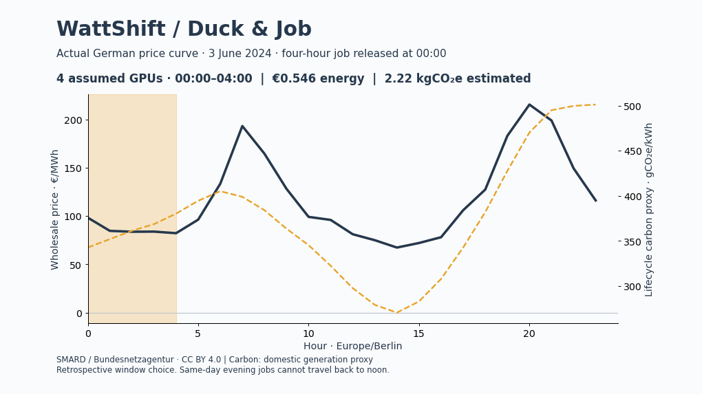
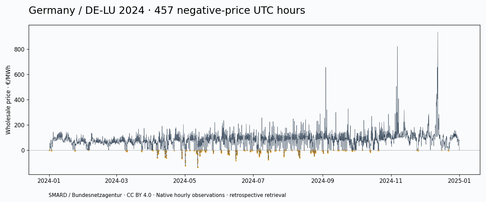
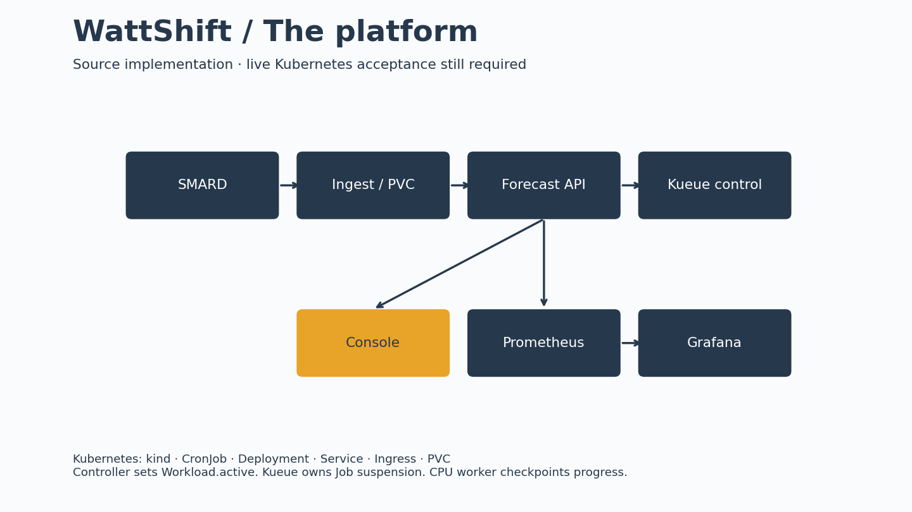
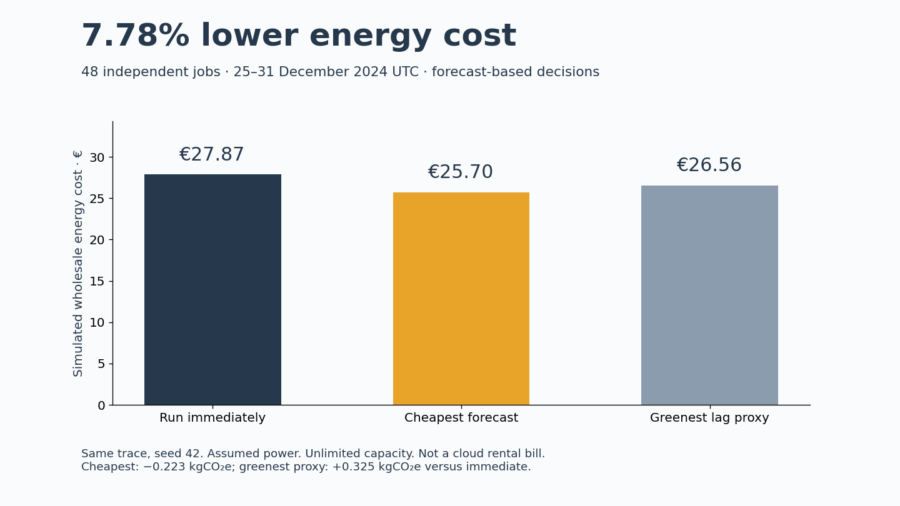

# WattShift

**Same GPUs. Cheaper hours. Cleaner power.**

A German electricity data platform and energy-aware batch scheduling experiment. The tagline describes the goal; carbon improvement is measured separately and is not guaranteed.


<!-- DAILY:START -->
Data unavailable for today
<!-- DAILY:END -->



**v1.0.0rc4 (independently reviewed preflight candidate; NOT live-cluster-verified) · 7.78% simulated energy-cost saving on one held-out week.**

[RC4 independent preflight audit](docs/reviews/rc4-preflight.md) · [RC3 admission-gate audit](docs/reviews/rc3-admission-audit.md) · [Zero-cost / 8 GB Mac plan](docs/LOW_RESOURCE.md). Historical `preview/` and archived evidence may show rc1; they do not prove a current frontend build.

[Run the Console](docs/RUNBOOK.md) · [2-minute evidence walkthrough](docs/assets/evidence-walkthrough.mp4) · [Reproduce the results](docs/METHOD.md) · [Verification and remaining gates](docs/reviews/final-review.md)

## 1. The problem

Flexible training and batch workloads can move within a deadline. The same energy use can cost different amounts at different hours. Negative wholesale prices are possible, but do not imply a negative retail electricity bill or cloud GPU rental bill.



“Duck & Job” is the visual nickname. A duck curve technically describes net load; this chart is a **price curve**. Jobs never move before their release time. Carbon is a domestic production-weighted lifecycle proxy with explicit assumptions, not marginal avoided emissions.

## 2. The platform



- Python SMARD ingestion, interval-preserving CSVs, SQLite upserts and source provenance.
- Seasonal baseline and LightGBM P10/P50/P90 forecasts, served by FastAPI.
- React / Vite / TypeScript / ECharts / Tailwind Console: **Today, Forecast, Jobs, Savings, Calculator**. Public snapshots and cluster API use the same code.
- Kubernetes CronJob, PVC, ConfigMap, Secret, probes, nginx, Traefik ingress; Prometheus and provisioned Grafana dashboard.
- Kueue `AdmissionCheck` blocks first admission until the WattShift controller marks the workload `Ready`. The controller no longer patches `Workload.spec.active` or `Job.suspend`; Kueue alone manages job execution. This blocks the original polling race **by design**; real cluster acceptance is still pending. A CPU demonstration worker checkpoints on termination and resumes its computation.

Docker, kind and kubectl are prerequisites on the host. With Python dependencies installed, `make up` provisions the full local stack. This environment could not execute Docker/kind: **the cluster workflow is implemented but not live-verified**.

## 3. The result



48 generated independent jobs, seed 42, 25–31 December 2024 UTC. Decisions use forecasts; costs use the same held-out actual prices. Constant power model: `(GPUs × 300 W + 100 W host) × PUE 1.2`.

| Policy | Energy cost | Saving versus immediate | Estimated carbon |
|---|---:|---:|---:|
| Immediate | €27.869 | — | 116.550 kgCO₂e |
| Cheapest forecast | €25.700 | €2.169 / **7.78%** | 116.327 kgCO₂e |
| Greenest lag-week proxy | €26.559 | €1.309 / 4.70% | 116.875 kgCO₂e |

The greenest proxy **increased** carbon by 0.325 kgCO₂e. Cheapest reduced the estimate by 0.223 kgCO₂e (about 0.19%). This is one small simulation, not a universal savings claim. Hindsight optimum cost: €25.258; forecast decision regret: €0.442. No capacity contention, rental fees, idle energy or checkpoint overhead are modeled.

Forecast MAE: 27.07 €/MWh versus seasonal baseline 58.45; P10–P90 coverage: 80.36% over 168 held-out hours. These bands are not guaranteed calibrated out of sample.

## Quickstart

```bash
python3 -m venv .venv
. .venv/bin/activate
pip install -r requirements.lock.txt pytest
make export
npm --prefix apps/console ci
npm --prefix apps/console run dev
```

Open the URL Vite prints. For API mode, run `make api` and build/start the Console with `VITE_MODE=cluster`. For the Kubernetes platform, install Docker, kind 0.31.0 and kubectl, then run `make doctor && make stack-lite` for the reduced stack or `make up` for the full observability stack. Neither profile is live-verified here. Console: `http://localhost:8080`.

```bash
make test
npm --prefix apps/console test
npm --prefix apps/console run test:ui
npm --prefix apps/console run build
python scripts/validate.py
python scripts/checkpoint_demo.py
```

The ZIP also contains `preview/`, the prebuilt static Console; serve that folder with any static HTTP server. Double-clicking index.html via `file://` cannot fetch its JSON.

## Project guide

[Runbook](docs/RUNBOOK.md) · [Method, data and limits](docs/METHOD.md) · [Phase 0–8 status](docs/ROADMAP.md) · [Requirements register](docs/REQUIREMENTS.md) · [Showcase copy](docs/SHOWCASE.md) · [GPU measurement](docs/GPU.md)

Daily snapshot and GitHub Pages workflows are supplied. They are not deployed; no public calculator URL, live Grafana screenshot, GitHub release history or GPU measurement is claimed. Runtime gates are listed in the final review. The packaged video is an evidence walkthrough, not a recording of a live cluster.

Built on a University of Bamberg MOBI team project. Original work and provenance are preserved unchanged inside `legacy/wattshift-prototype.zip`; the WattShift extension must not be presented as solely original team work. Data: [SMARD / Bundesnetzagentur](https://www.smard.de), CC BY 4.0; this repository transforms the data. See per-dataset provenance and [emission factors](config/emissions.json).
